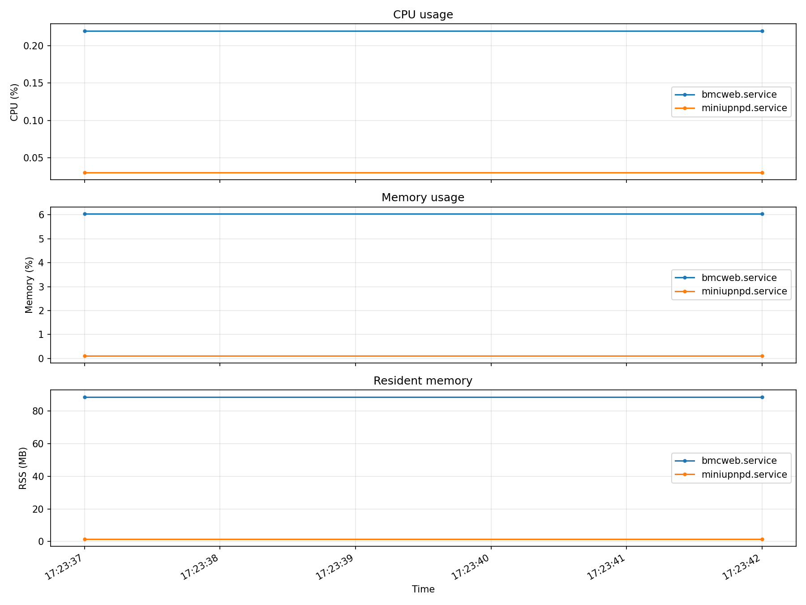

# RemoteServiceMonitor

Monitor CPU and memory usage of remote systemd services over SSH.  
One SSH connection is opened per run, all services are sampled, then the connection is closed.  
Every measurement is printed and optionally appended to a CSV file. A time-series
PNG plot is saved after each run.

---

## Requirements

- Python 3.10+
- [paramiko](https://www.paramiko.org/)
- matplotlib

```bash
pip install -r requirements.txt
```

---

## Quick Start

```bash
# Edit config.json to point at your host and services
python3 monitor.py              # uses config.json by default
python3 monitor.py my.json      # use a custom config file
```

---

## Configuration (`config.json`)

```json
{
  "host": {
    "host": "192.168.1.100",
    "port": 22,
    "username": "root",
    "passwd": "yourpassword",
    "keyfile": null,
    "timeout": 10,
    "verify_host_key": false
  },
  "services": [
    "bmcweb.service",
    "phosphor-logging.service"
  ],
  "sampling": {
    "range_mins": 1,
    "interval_secs": 5
  },
  "output": {
    "csv_file": "results/monitor_samples.csv",
    "plot_file": "results/monitor_timeseries.png"
  }
}
```

### `host`

| Field             | Type    | Required | Description |
|-------------------|---------|----------|-------------|
| `host`            | string  | yes      | IP address or hostname of the remote machine |
| `port`            | integer | no       | SSH port (default `22`) |
| `username`        | string  | yes      | SSH login username |
| `passwd`          | string  | *        | Password — used when `keyfile` is null/empty |
| `keyfile`         | string  | *        | Path to private key file, e.g. `~/.ssh/id_rsa` — takes priority over `passwd` |
| `timeout`         | number  | no       | SSH connect timeout in seconds (default `10`) |
| `verify_host_key` | boolean | no       | Reject unknown host keys when `true` (default `false`) |

\* At least one of `passwd` or `keyfile` must be set (non-null, non-empty).  
Auth priority: `keyfile` → `passwd` → SSH agent (when both are null).

### `services`

A JSON array of systemd unit names to monitor. Only `*.service` units are accepted.

```json
"services": ["bmcweb.service", "phosphor-logging.service"]
```

### `sampling`

| Field           | Type   | Description |
|-----------------|--------|-------------|
| `range_mins`    | number | Total monitoring duration in minutes |
| `interval_secs` | number | Seconds between each sample |

The number of samples taken is `round(range_mins × 60 / interval_secs)`.

### `output`

| Field      | Type   | Description |
|------------|--------|-------------|
| `csv_file` | string | Path to append every individual sample to. Set to `null` or `""` to disable CSV output. |
| `plot_file` | string | Path for the generated CPU, memory, and RSS time-series PNG (default `results/monitor_timeseries.png`). |

The directory is created automatically if it does not exist.

---

## How It Works

```
main()
  ├── validate config
  ├── open SSH connection     (once)
  ├── check service status    → systemctl show --property=ActiveState
  ├── filter to active services
  ├── sampling loop
  │     └── per service, per interval:
  │           query_service() → reads /proc/<MainPID>/stat + /proc/<MainPID>/status
  ├── close SSH connection    (once)
  ├── print_samples()            → print every timestamped measurement
  ├── save_samples_csv()         → append every measurement (if enabled)
  └── plot_samples()             → save CPU, memory, and RSS vs. time
```

**Why `/proc` instead of `ps`?**  
OpenBMC uses BusyBox `ps`, which has no column-selection (`-o`) support.  
Reading `/proc/<pid>/stat` and `/proc/<pid>/status` directly is always available.

**CPU% formula:**  
`(utime + stime) / CLK_TCK / process_age × 100`  
This is the process lifetime-average CPU%, as reported by `ps %cpu`. The chart
plots each collected value as-is; it does not calculate a run-wide average.

**Non-active services** are detected before sampling and skipped.

---

## Example Output

```
Connecting to 192.168.9.227 ...
Connected.

  Checking service status ...
  Service                           Status
  --------------------------------  ------
  bmcweb.service                    active
  miniupnpd.service                 inactive  [SKIP — not active]

  Sampling 1 service(s) every 5.0s for 60s (12 sample(s)) ...
  [ 1/12] 2026-04-22 16:58:43
  ...
  [12/12] 2026-04-22 16:59:39

Connection to 192.168.9.227 closed.

REMOTE SERVICE MONITOR — SAMPLES   host=192.168.9.227
  Timestamp           Service                            PIDs     CPU%     MEM%     RSS MB
  2026-04-22 16:58:43 bmcweb.service                        1     0.11     2.26      21.15
  ...

Samples appended to: results/monitor_samples.csv
Time-series plot saved to: results/monitor_timeseries.png
```

The plot contains separate CPU%, memory%, and RSS panels. Each service is a
separate line, with one marker for each successful sample.

Example plot from live measurements:



---

## CSV Output

Each run appends one row per successful sample to the CSV file. A header is written automatically on first creation.

| Column          | Description |
|-----------------|-------------|
| `timestamp` | Wall-clock time when this sample was collected |
| `host`          | Host IP/name from config |
| `service`       | Systemd unit name |
| `svc_status`    | `active`, `inactive`, `failed`, etc. |
| `pid_count`     | Number of processes included in this sample |
| `cpu_percent`   | CPU% for this sample |
| `mem_percent`   | Memory% (RSS / MemTotal) for this sample |
| `rss_mb`        | RSS (Resident Set Size) in megabytes for this sample |

---

## Project Structure

```
RemoteServiceMonitor/
├── monitor.py       # main script
├── config.json      # host / service / sampling configuration
├── requirements.txt
├── .gitignore
└── results/         # CSV and plot output directory (auto-created)
```

---

## Security Notes

- For production use, set `"verify_host_key": true` and ensure the host is in `~/.ssh/known_hosts`.
- Avoid committing `config.json` with real credentials. Use a gitignored copy (e.g. `config.local.json`) and pass it as an argument:
  ```bash
  python3 monitor.py config.local.json
  ```
- Service names are validated against `^[\w:.@-]+\.service$` before being passed to any remote command.

