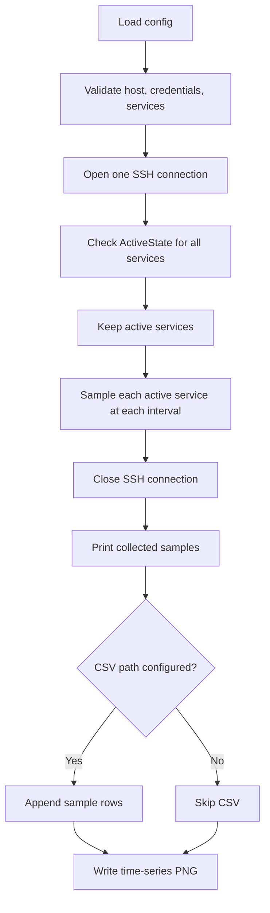

# Design

## Purpose

RemoteServiceMonitor is a command-line, single-run utility for collecting CPU
and memory measurements from configured systemd services on a remote Linux host.
It connects over SSH, samples active services for a bounded period, prints the
individual observations, optionally appends them to CSV, and writes a
time-series PNG. It is not a background daemon or a long-term monitoring
service.

The implementation is in [monitor.py](../monitor.py). User-facing setup and
configuration details are in [README.md](../README.md).

## Runtime flow

`main()` loads `config.json` by default, or the path supplied as the first
command-line argument. It validates that at least one service and either a
password or key file are configured. Service names must match the accepted
`*.service` pattern before they are inserted into remote shell commands.

One Paramiko SSH client is opened per run and reused for status checks and
sampling. Host-key checking is disabled by default; set
`host.verify_host_key` to `true` to use system known-host keys and reject
unknown keys. Authentication uses the configured key file when present,
otherwise the configured password. Agent-only authentication is not currently
accepted by `main()` validation.

## Measurement model

Before sampling, `check_all_services()` obtains each service's systemd
`ActiveState`. Only services whose state is `active` are sampled. A sample is
collected per active service per sampling cycle; a query that returns no valid
process data produces no sample row.

`query_service()` runs a remote shell query that:

1. Finds the service cgroup and reads its `cgroup.procs`, with a cgroup-v1
   systemd path fallback and a `MainPID` fallback.
2. Reads each discovered process's `/proc/<pid>/stat` and `/proc/<pid>/status`.
3. Reads system uptime and total memory once for the service query.

Sentinel lines separate process and system data in the command output. The
parser turns a successful query into a `ProcessSample` with a local wall-clock
timestamp, valid PID count, CPU percentage, memory percentage, and RSS in MiB.

### Metric semantics

- **CPU%:** For each process, `(utime + stime) / CLK_TCK / process_age × 100`;
  process values are summed for the service. This is a process-lifetime average,
  not CPU utilization during only the latest sampling interval.
- **Memory%:** Total RSS for valid service processes divided by system
  `MemTotal`, multiplied by 100.
- **RSS MB:** Total RSS for valid service processes, converted from KiB to MiB.
- **PID count:** Number of processes for which both CPU and RSS data were
  successfully parsed.

The timestamp is local time with one-second resolution and does not include a
timezone. The sampling loop sleeps for the configured interval after querying
all services, so query time adds to the time between cycle starts. The number of
cycles is `max(1, round(range_mins × 60 / interval_secs))`.

## Outputs

### Console

After sampling completes, `print_samples()` prints every successful sample in
timestamp order. It does not compute per-run minimum, maximum, or average
statistics.

### CSV

When `output.csv_file` is a non-empty path, `save_samples_csv()` creates the
parent directory as needed and appends one row per successful sample. A header
is written for a new or empty file. Fields are:

`timestamp`, `host`, `service`, `svc_status`, `pid_count`, `cpu_percent`,
`mem_percent`, and `rss_mb`.

The CSV accumulates observations across runs. Existing files using the former
summary-row schema should be replaced or given a new path before appending this
sample schema.

### Plot

`plot_samples()` writes three vertically stacked time-series panels: CPU%,
memory%, and RSS. Each service is a separate line and each sample is marked.
The graph uses only the samples from the current run and overwrites the
configured `output.plot_file` (default:
`results/monitor_timeseries.png`). If there are no successful samples, the plot
is skipped. CSV logging is optional; plot generation is enabled by default.

## Dependencies and remote assumptions

- Python 3.10 or later.
- Paramiko for SSH and Matplotlib for PNG rendering; see
  [requirements.txt](../requirements.txt).
- The remote target provides systemd, a POSIX-compatible shell, `/proc`, and
  readable cgroup process lists for the monitored services.
- The remote commands inspect state only; they do not start, stop, or modify
  services.

## Known limitations

- CPU values are lifetime averages, so plotting them at each timestamp does not
  make them interval-specific CPU readings.
- The SSH connection is not automatically reconnected. An SSH error during
  sampling propagates out of the sampling loop; because output is written after
  the loop, that failed run does not print, save, or plot its partial samples.
- Sampling and timestamps use wall-clock time; timestamps have one-second
  precision, and measurements from different services in one cycle may share a
  timestamp.
- The plot is replaced on each run. Historical data is retained only when CSV
  output is enabled.
- Host-key verification defaults to off for compatibility. Enable it for
  production use and manage the host key in the user's known-hosts file.
- Credentials must not be committed. Use a private, ignored configuration
  file when storing a real password or key path.